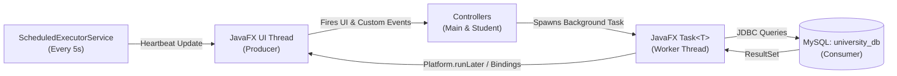
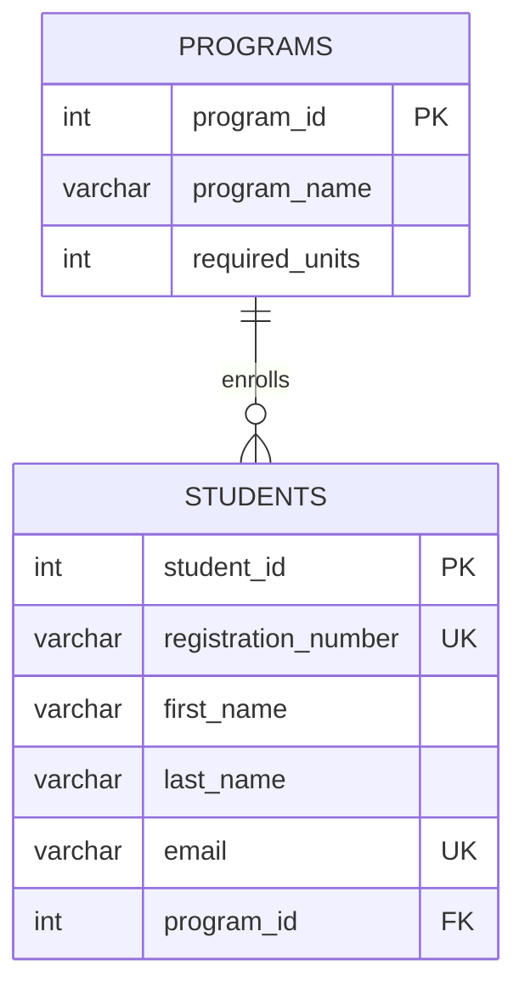

# University Management System (Event-Driven Architecture)

A JavaFX + MySQL desktop application built in **VS Code** using **Maven**, demonstrating Event-Driven Programming principles from Weeks 6–10.

## Learning Outcomes Covered
- **Week 6 (Modern JavaFX):** Maven project setup, `Stage`/`Scene`/`Node` hierarchy, FXML + Controllers, `BorderPane` navigation.
- **Week 7 (Event Handling):** Action events and Custom Events (`StudentSavedEvent`) bubbling from child views to `MainController`.
- **Week 8 (Properties & Bindings):** Observable `Student` model (`StringProperty`, `IntegerProperty`), `TableView` bindings, and reactive form validation (`saveButton.disableProperty().bind(...)`).
- **Week 9 (Asynchronous Programming):** `LoadStudentsTask` & background `Task<Void>` for MySQL operations, `ProgressIndicator` binding, and `Platform.runLater()`.
- **Week 10 (Capstone EDA):** Separation of UI (Producer) and MySQL Database (Consumer), plus a `ScheduledExecutorService` 5-second system heartbeat.

## System Architecture Diagram


## Database ERD


## Setup Instructions (MySQL + VS Code)

### 1. Set Up MySQL Database
1. Open **MySQL Workbench** (or MySQL CLI).
2. Run the script in `database/university_db.sql`.
3. Open `src/main/java/com/university/DatabaseUtil.java` and update `PASSWORD` to your local MySQL password.

### 2. Run in VS Code
1. Open the `UniversitySystem` folder in **VS Code** (with the *Extension Pack for Java* installed).
2. Open the integrated terminal and run:
   ```bash
   mvn clean javafx:run
   ```

### 3. Push to GitHub
```bash
git init
git add .
git commit -m "Complete Event-Driven Programming Final Project: University Management System"
git branch -M main
git remote add origin https://github.com/<your-username>/UniversitySystem.git
git push -u origin main
```
